# Лабораторная работа №1. Отказоустойчивый кластер PostgreSQL

## Цель работы

Цель работы — развернуть в Docker отказоустойчивый кластер PostgreSQL, настроить репликацию данных между двумя узлами и проверить автоматическое переключение на резервный узел при отказе лидера.

В работе используются PostgreSQL, Patroni, ZooKeeper и HAProxy.


## 1. Подготовка образа PostgreSQL и Patroni

За основу был взят образ `postgres:15`. В него были добавлены Python, Patroni, поддержка ZooKeeper и библиотека для подключения к PostgreSQL.

Конфигурации двух нод копируются в образ, после чего Patroni можно запускать как обычную команду.

```dockerfile
FROM postgres:15

RUN apt-get update -y && \
    apt-get install -y \
        netcat-openbsd \
        python3-pip \
        python3-venv \
        curl \
        iputils-ping && \
    rm -rf /var/lib/apt/lists/*

RUN python3 -m venv /opt/patroni-venv && \
    /opt/patroni-venv/bin/pip install --upgrade pip && \
    /opt/patroni-venv/bin/pip install "patroni[zookeeper]" psycopg2-binary

COPY postgres0.yml /postgres0.yml
COPY postgres1.yml /postgres1.yml

ENV PATH="/opt/patroni-venv/bin:${PATH}"

USER postgres
```

## 2. Настройка кластера

В `docker-compose.yml` были описаны две ноды PostgreSQL и контейнер ZooKeeper.

Для прямого подключения к нодам используются разные внешние порты:

| Сервис | Порт на компьютере | Порт в контейнере |
|---|---:|---:|
| `pg-master` | 5433 | 5432 |
| `pg-slave` | 5434 | 5432 |
| ZooKeeper | 2181 | 2181 |
| HAProxy | 5435 | 5432 |
| Статистика HAProxy | 7001 | 7000 |

Порты `5435` и `7001` были выбраны потому, что `5432` и `7000` на компьютере уже использовались другими процессами. Внутренние порты контейнера HAProxy при этом не изменялись.

Для каждой ноды настроен отдельный Docker volume, поэтому их данные не смешиваются и сохраняются при обычном перезапуске контейнеров.

## 3. Конфигурация Patroni

В файлах `postgres0.yml` и `postgres1.yml` указан общий кластер:

```yaml
scope: postgres-cluster
```

Ноды отличаются именами и адресами:

```text
postgres0 → pg-master
postgres1 → pg-slave
```

Обе ноды используют ZooKeeper по адресу `zoo:2181`. Также включены replication slots, `pg_rewind`, синхронный режим и необходимые параметры WAL.

Основные параметры:

```yaml
synchronous_mode: true
use_pg_rewind: true
use_slots: true
wal_level: replica
hot_standby: "on"
wal_log_hints: "on"
```

Patroni запускает PostgreSQL и определяет, какая нода будет лидером, а какая — синхронной репликой.

## 4. Запуск кластера

Кластер был собран и запущен командой:

```bash
docker compose up -d --build
```

После запуска были созданы три контейнера: две ноды PostgreSQL и ZooKeeper.

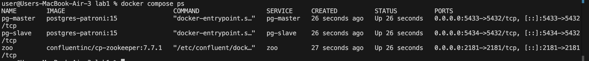

Состояние Patroni было проверено командой:

```bash
docker exec -it pg-master patronictl -c /postgres0.yml list
```

По результату проверки `postgres0` стал лидером, а `postgres1` — синхронной репликой. Реплика находилась в состоянии `streaming`, отставание было равно нулю.

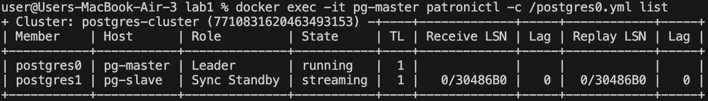

## 5. Проверка репликации

Сначала было выполнено подключение к лидеру:

```bash
docker exec -it pg-master psql -U postgres -d postgres
```

Запрос `pg_is_in_recovery()` вернул `false`, что подтверждает роль лидера.

Затем была создана тестовая таблица и добавлена первая строка:

```sql
SELECT pg_is_in_recovery();

CREATE TABLE lab_test (
    id SERIAL PRIMARY KEY,
    message VARCHAR(255)
);

INSERT INTO lab_test (message)
VALUES ('hello from master');

SELECT * FROM lab_test;
```

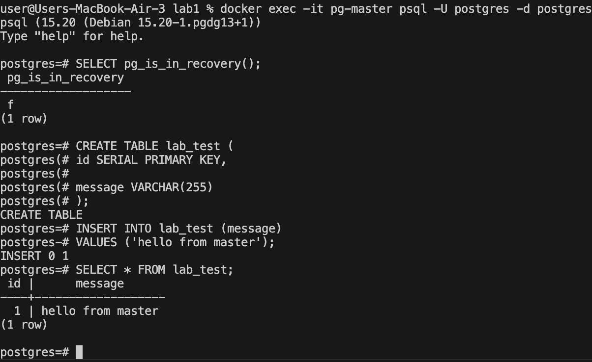

После этого было выполнено подключение к реплике:

```bash
docker exec -it pg-slave psql -U postgres -d postgres
```

На второй ноде `pg_is_in_recovery()` вернул `true`. Таблица и созданная на лидере строка появились автоматически.

Попытка выполнить `INSERT` непосредственно на реплике завершилась ошибкой `cannot execute INSERT in a read-only transaction`. Это подтверждает, что реплика работает в режиме только для чтения.

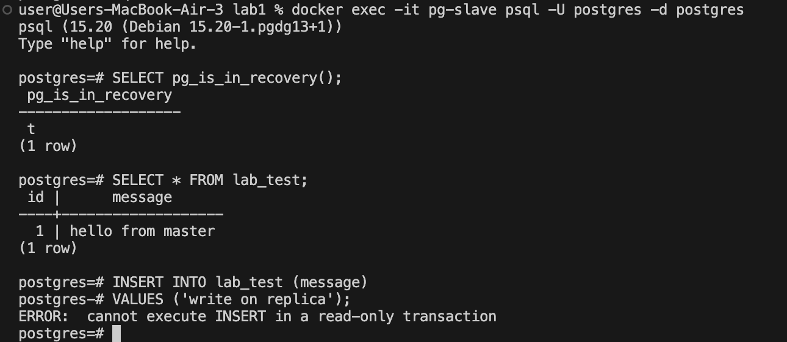

## 6. Настройка HAProxy

HAProxy был добавлен как отдельный контейнер. Он проверяет REST API Patroni на порту `8008` и считает доступной для записи только ноду, которая отвечает кодом `200` на запрос `/primary`.

Основная часть конфигурации:

```text
listen postgres
    bind *:5432
    option httpchk GET /primary
    http-check expect status 200
    default-server inter 3s fall 3 rise 2 on-marked-down shutdown-sessions
    server postgres0 pg-master:5432 maxconn 100 check port 8008
    server postgres1 pg-slave:5432 maxconn 100 check port 8008
```

После добавления HAProxy работали четыре контейнера.

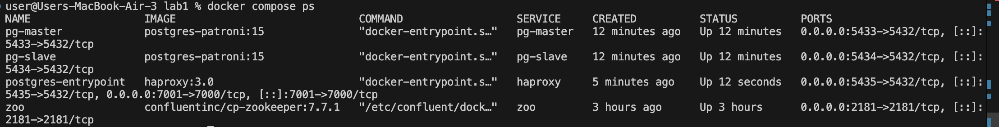

На странице статистики HAProxy нода `postgres0` отображалась как `UP`, а `postgres1` — как `DOWN`.

Статус `DOWN` в этой таблице не означает поломку реплики. Проверка выполняется для точки записи, поэтому HAProxy исключает из неё все ноды, которые не являются текущим лидером.

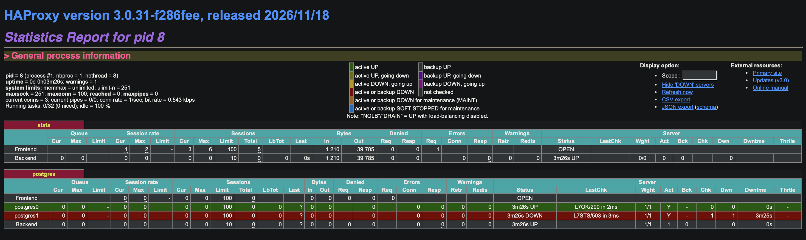

## 7. Запись через HAProxy

Для проверки единой точки подключения был запущен клиент `psql`, который подключался к адресу `postgres-entrypoint:5432`:

```bash
docker exec -e PGPASSWORD=postgres -it pg-master \
  psql -h postgres-entrypoint -p 5432 -U postgres -d postgres
```

HAProxy направил соединение на текущего лидера. Запрос `pg_is_in_recovery()` вернул `false`, после чего была успешно добавлена новая запись.

```sql
INSERT INTO lab_test (message)
VALUES ('insert through haproxy');
```

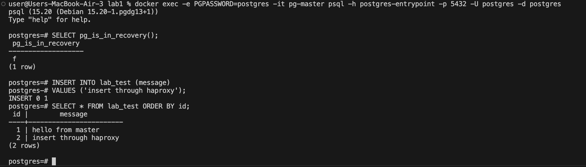

## 8. Проверка отказоустойчивости

Для имитации отказа контейнер текущего лидера был остановлен:

```bash
docker stop pg-master
```

После завершения времени обнаружения отказа Patroni автоматически повысил `postgres1` до роли `Leader`.

```bash
docker exec -it pg-slave patronictl -c /postgres1.yml list
```

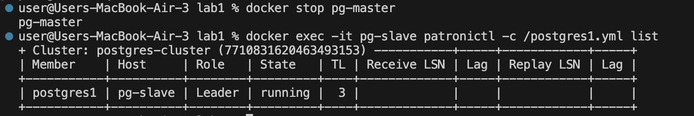

HAProxy также обнаружил изменение ролей. Нода `postgres0` стала недоступна, а `postgres1` начала отвечать кодом `200` и стала активной точкой записи.

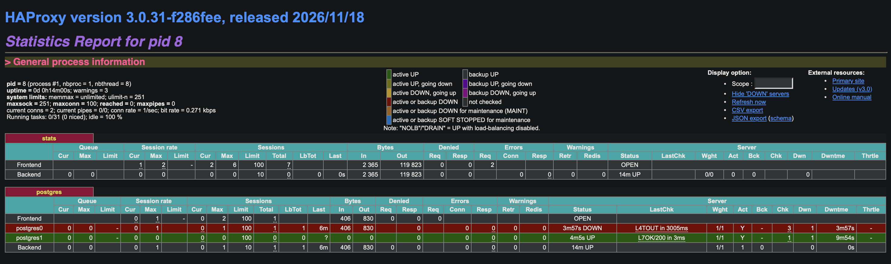

## 9. Работа после переключения

Подключение снова выполнялось через тот же адрес `postgres-entrypoint:5432`, то есть клиенту не пришлось узнавать адрес нового лидера.

Старые строки сохранились, а запись после переключения была выполнена успешно:

```sql
INSERT INTO lab_test (message)
VALUES ('insert after failover');
```

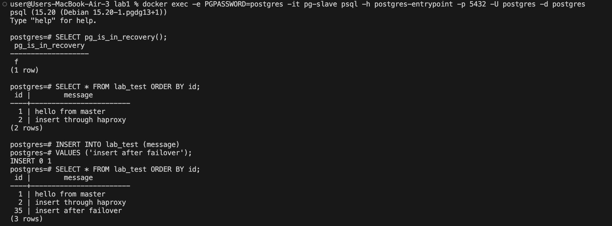

Номер новой строки получился не последовательным. Это допустимо, потому что PostgreSQL sequence не гарантирует отсутствие пропусков после неудачных операций и переключений.

## 10. Возвращение отключённой ноды

Старая нода была возвращена командой:

```bash
docker start pg-master
```

Она не забрала роль лидера обратно, а подключилась к кластеру как `Sync Standby`. Репликация перешла в состояние `streaming`, а отставание стало равно нулю.

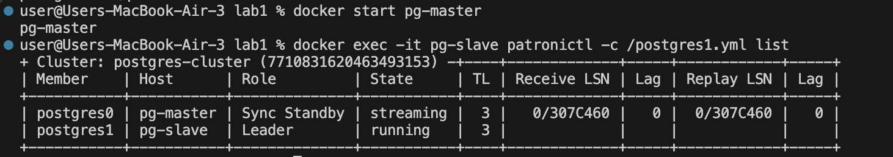

На вернувшейся ноде присутствовала строка `insert after failover`, созданная во время её отсутствия. Значит, после запуска нода автоматически получила пропущенные изменения от нового лидера.

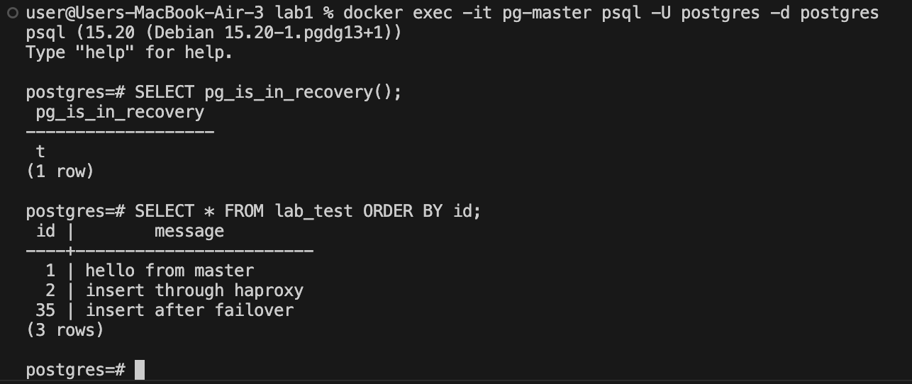

Финальное состояние HAProxy показывает, что `postgres1` остаётся активным лидером, а `postgres0` работает как реплика и не используется для записи.

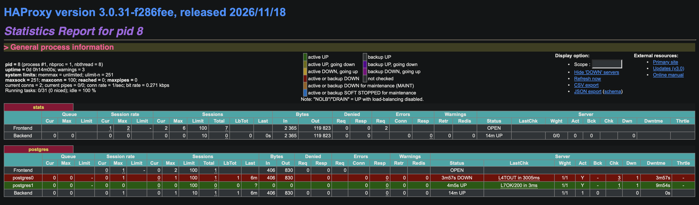

## 11. Ответы на вопросы

### В чём разница между `expose` и `ports`?

`expose` указывает порт, который используется другими контейнерами внутри Docker-сети. Он не открывает этот порт напрямую на компьютере.

`ports` выполняет проброс порта из контейнера на компьютер. Например, запись `5433:5432` означает, что порт `5432` внутри контейнера доступен на компьютере через `localhost:5433`.

### Будет ли образ пересобран при обычном перезапуске Docker Compose?

Нет. При обычном `docker compose restart` или `docker compose up -d` Docker использует уже собранный образ, если его конфигурация сборки не изменилась и явно не запрошена пересборка.

В нашей работе файлы `postgres0.yml` и `postgres1.yml` копируются внутрь образа командой `COPY`. Поэтому после их изменения нужно пересобрать образ:

```bash
docker compose up -d --build
```

После изменения `Dockerfile` также требуется пересборка. Неизменённые слои Docker при этом могут быть взяты из кэша.

Файл `haproxy.cfg` подключается через bind mount, поэтому его изменение не требует сборки нового образа. Достаточно перезапустить HAProxy:

```bash
docker compose restart haproxy
```

## 12. Анализ failover

После остановки лидера Patroni перестал получать от него подтверждение состояния через ZooKeeper. По истечении времени обнаружения отказа доступная синхронная реплика была повышена до лидера.

HAProxy регулярно проверял REST API Patroni. Когда старая нода перестала отвечать, она была исключена из backend. После повышения второй ноды её endpoint `/primary` начал возвращать код `200`, и новые подключения стали направляться на неё.

Адрес подключения для клиента не изменился. До отказа и после него использовался `postgres-entrypoint:5432` внутри Docker-сети или `localhost:5435` с компьютера.

После запуска старой ноды Patroni присоединил её как реплику. Благодаря `pg_rewind`, replication slots и WAL она получила данные, записанные во время её отсутствия.

## Вывод

В ходе лабораторной работы был развёрнут отказоустойчивый кластер PostgreSQL из двух нод. Patroni и ZooKeeper обеспечили выбор лидера и автоматическое переключение, а HAProxy предоставил одну точку подключения к базе данных.

Была проверена потоковая репликация, запрет записи на резервную ноду, запись через HAProxy, автоматический failover и возврат старой ноды в кластер. После отключения первоначального лидера вторая нода автоматически стала новым лидером, а клиент продолжил работу через прежний адрес. После возвращения старая нода получила пропущенные данные и стала синхронной репликой.
